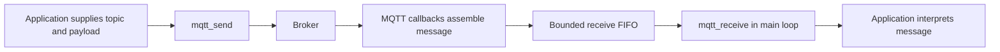

# MQTT framework and two-board demo

## MQTT feedback update

Start with the beginner-friendly [protocol and ownership guide](docs/MQTT_PROTOCOL.md)
and [local broker walkthrough](docs/LOCAL_BROKER.md). The transport now supports
QoS 0/1 subscriptions and publishing, retained publishing, copied Last Will
configuration, and optional publish completion callbacks. The existing demo
announces retained online/offline presence; full game recovery is a documented
integration contract, not implemented game behaviour.

Set `MQTT_BROKER_HOST` in `config/network_config.h` to your local broker PC's
address before flashing. Its default local hostname is a deployment placeholder.
The public HiveMQ broker is no longer the default.

The network module transports messages. It does not assign board identities,
construct application topics, interpret game events or choose LED colours.
The identity/layout owner supplies complete topics; application modules decide
what their payloads mean.

## What is implemented

- Configurable subscriptions, copied into owned storage.
- Automatic MQTT reconnect attempts and subscription restoration.
- Runtime subscription registration, with retries when a request fails.
- Generic publishing with explicit payload length (text or binary).
- A bounded FIFO of complete received messages, including fragmented payloads.
- Connection/readiness queries and a cumulative received-message discard counter.

The application in `main.c` is a working integration example: moving Node 1's
sensor publishes GREEN/RED to Node 2, whose application code changes its LEDs.
Both nodes also publish status once a second. Those demo messages and node
numbers are not built into the MQTT framework.

## Standard Wi-Fi setup (current build)

The standard firmware uses `WIFI_SSID` and `WIFI_PASSWORD` from
`config/wifi_creds.h`. `main.c` supplies them to
`wifi_init_and_connect(WIFI_SSID, WIFI_PASSWORD)`. Open the USB serial monitor
to start the board; no credential-entry prompt appears. Changing the configured
network requires rebuilding and reflashing. The connection attempt can take up
to 30 seconds. On startup failure, check the settings/network and restart.

The reusable Wi-Fi module still accepts credentials as parameters; it does not
include the credentials file itself. Never share that file's passwords in logs
or presentations.

## Optional advanced Wi-Fi setup (saved separately)

The serial-prompt version is preserved as:

- `build/LED_MEMORY_GAME_node1_advanced_wifi_setup.uf2`
- `build/LED_MEMORY_GAME_node2_advanced_wifi_setup.uf2`

Those snapshots ask for a network name and password on every restart, using
USB serial at 115200 baud with LF, CR or CRLF line endings. They accept a 1-32
byte SSID and an 8-63 byte WPA2 passphrase, retry after connection failure and do
not save credentials to flash. The firmware does not echo the password; the
terminal's own input box/local echo may still show it.

The optional source remains in `src/network/wifi_setup.c/.h`, but is excluded
from the standard build. To re-enable it, add `wifi_setup.c` to CMake's source
list, include `wifi_setup.h` in `main.c`, and replace the hardcoded startup
connection block with `wifi_setup_prompt()`. Standard builds do not overwrite
the separately named advanced UF2 snapshots. Live network switching while MQTT
is active and flash persistence are not implemented.

## Interface for teammates

Include `mqtt_handler.h`. Initialise the Wi-Fi architecture before using the
MQTT APIs. Call them from the main loop; locks are handled inside the module.

```c
// After wifi_init_and_connect(ssid, password) succeeds:
// The layout/identity module supplies this full topic string.
if (!mqtt_subscribe_topic(command_topic)) {
    // Invalid filter, too long, or subscription table full: report setup failure.
}

// Call on every main-loop iteration while Wi-Fi is available, even when connected.
// client_id must stay valid for the lifetime of the connection.
init_mqtt_client(client_id);

if (mqtt_is_ready()) {
    mqtt_message_t message;
    // Limit the batch so a busy queue cannot starve other application tasks.
    for (size_t i = 0; i < MQTT_RX_QUEUE_CAPACITY && mqtt_receive(&message); ++i) {
        // Dispatch message.topic, message.payload and message.length to your module.
        // The payload is NOT null-terminated. Do not use printf("%s", message.payload).
    }
}

// Example outgoing selection; the framework does not interpret this text.
const char selection[] = "SELECT:2";
bool queued = mqtt_send("game/input", selection, sizeof(selection) - 1);
```

`mqtt_subscribe_topic(topic)` returning true means the topic was registered
locally. `mqtt_is_ready()` becomes true only when connected and every registered
subscription has received a successful broker response. With no subscriptions,
ready simply means connected. Registering a new topic makes ready false until
that topic is accepted. Re-registering the same topic is harmless.

`mqtt_send(topic, payload, length)` returning true means the message was queued
locally. It does not prove the broker or another board processed it. Publishing
uses QoS 0 and retain=false. `mqtt_send_ex` additionally supports QoS 1, retain
and a completion callback. `mqtt_subscribe_topic_qos` selects subscription QoS.
The receiver must already be subscribed for an unretained message.
`mqtt_receive(&message)` removes the oldest complete message and copies it into
caller-owned storage. It returns false for an empty queue or NULL destination.

Topic strings must be valid MQTT UTF-8 strings. The framework checks length and
wildcard placement; it does not validate UTF-8 encoding. Subscription filters
support `+` and `#`. Publish topics must not contain wildcards.

## Limits and failure behaviour

| Resource | Limit / policy |
| --- | --- |
| Registered subscriptions | 8 unique filters, each copied; no removal API yet |
| Topic/filter length | 95 bytes, excluding the terminating zero |
| Payload length | 256 bytes; binary data and empty payloads supported |
| Receive queue | 8 complete messages, FIFO |
| Full queue | Drop newest arriving message, preserve already queued messages |
| Oversized or malformed incoming message | Discard the complete message |
| Disconnect | Discard queued and partial incoming messages; retain subscription list |
| Discard reporting | `mqtt_received_drop_count()`, cumulative uint32 counter |
| Offline publishing | Return false; no outgoing/offline queue |
| MQTT connection retry | Five-second minimum interval |
| Subscription retry | One-second minimum after failure; one request in flight |

`init_mqtt_client` must continue to run for retry servicing. During reconnect,
readiness stays false until subscriptions are restored. Already received
messages are cleared on disconnect so old demo/game actions are not replayed.
Topics exceeding lwIP's own receive-header buffer may be rejected by the library
before reaching the framework; teammates should respect the documented limits.

This is not yet the full network statechart: an outgoing application queue,
application delivery replies, Wi-Fi rejoin logic, node discovery and state
resynchronisation are future work. QoS 1 completion reports broker acknowledgement,
not display application. Last Will reports loss after the broker detects it;
the demo does not monitor all required boards or pause gameplay.

## Code map

| File | Owner/responsibility |
| --- | --- |
| `src/network/mqtt_handler.h` | Public framework API and message limits |
| `src/network/mqtt_handler.c` | Broker connection, subscription list, message assembly and FIFO |
| `config/network_config.h` | Broker host and port |
| `src/network/wifi_manager.c` | Initial Wi-Fi connection |
| `src/main.c` | Demo application: supplies topics, publishes motion and interprets colours |
| `config/node_config.h` | Demo node numbers, complete topic strings and motion settings |
| `src/sensors/imudriver.c` | Demo sensor driver, GY-511/LSM303DLHC on GP0/GP1 |
| `src/sensors/motion_detector.h` | Demo motion detection and cooldown |
| `src/display/ledmatrix.c` | Demo WS2812 output: 64 pixels on GP2 |

The MQTT module has no dependency on `node_config.h`, sensor code or LED code.
Its callbacks only collect data and update networking state. Application code
pops messages in the main loop and performs hardware/game actions there.
The Pico SDK services networking in the background; this demo is not FreeRTOS.
Game-engine and audio files remain unfinished team placeholders.



## Run the existing demo after the framework change

1. Flash `build/LED_MEMORY_GAME_node2.uf2` onto Node 2, open its serial monitor,
   and wait for `Subscribed to se4/memorygame/node2/command`.
2. Flash `build/LED_MEMORY_GAME_node1.uf2` onto Node 1 and open its monitor.
3. Hold Node 1's sensor still for a second, then briefly move it. Node 2 should
   alternate green/red on successive recognised movements. Node 1 stays pink.
4. Publish RED, GREEN or OFF from the browser to either board's command topic,
   QoS 0 and Retain unchecked. The targeted board should respond.
5. Publish `SELECT:2` to a demo command topic. The transport will deliver it;
   the colour demo should print an unrecognised-payload message, not change LEDs.

For future builds, set NODE_ID to the intended board, compile, then flash
`build/LED_MEMORY_GAME.uf2`. Normal builds overwrite that generic filename but
do not refresh the separately labelled snapshot files. The current source is
set to Node 1. Do not flash Node 1's firmware onto both boards.

Both boards wait for a USB serial monitor at startup. COM numbers may
change after flashing, and only one serial monitor can open each port. Closing
its connection after startup does not stop the firmware. Avoid sharing screenshots of your terminal password-entry box.

## Troubleshooting

- Connection exists but not ready: look for failed subscription logs and keep
  calling `init_mqtt_client` so the subscription retry can run.
- No received messages: check the exact supplied topics, ready state and discard
  counter. Ensure the receiver subscribed before the sender published.
- LEDs do not understand a new command: update the application parser, not MQTT.
- Raw sensor diagnostics: set IMU_LOG_READINGS=1 in `node_config.h`.
- MQTT diagnostics: set MQTT_DEBUG to LWIP_DBG_ON in `lwipopts.h` (Debug build).
- Sensor missing at boot: fix wiring/power and restart. Runtime reads use timeouts.
- Motion sensitivity: adjust MOTION_THRESHOLD_MG / MOTION_COOLDOWN_MS. This is a
  desk-motion test, not calibrated panel taps; mounting is still needed.

## Validation

Run all host suites, including the reconnection cases, with:

```powershell
powershell.exe -NoProfile -ExecutionPolicy Bypass -File tests/run_host_tests.ps1
```

See [Reconnection test results](docs/MQTT_RECONNECTION_TESTS.md) for coverage,
limitations and the hardware tests that remain pending.


Host tests use stubbed SDK calls to exercise the actual MQTT module. They cover
subscription registration/copying/limits, late registration, retry and readiness,
fragmented binary/empty/maximum-sized messages, FIFO overflow, invalid inputs,
disconnect cleanup and resubscription. They do not replace a hardware/broker test.

```powershell
& C:/msys64/mingw64/bin/gcc.exe -std=c11 -Wall -Wextra -Werror -Itests/mqtt_stubs -Isrc/network -Iconfig tests/mqtt_handler_test.c src/network/mqtt_handler.c -o build/mqtt_handler_test.exe
& ./build/mqtt_handler_test.exe
& C:/msys64/mingw64/bin/gcc.exe -std=c11 -Wall -Wextra -Werror -Iconfig -Isrc/sensors tests/motion_detector_test.c -o build/motion_detector_test.exe
& ./build/motion_detector_test.exe
```

Both node firmware builds and host tests are checked. The two-board sensor demo
worked before this framework change; repeat the steps above on the new firmware.
