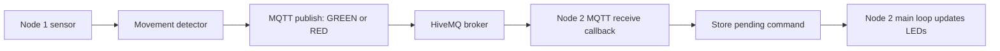

# LED memory game: working communication demo

Start here when explaining this project. The current firmware is a two-Pico
movement demo. Card matching, game-state management and panel-tap calibration
are still future work.

## The explanation to give your teammates

> Each Pico runs the same C program with a different NODE_ID. Node 1 reads its
> GY-511 accelerometer and detects a sudden movement. It publishes GREEN or RED
> to Node 2's command topic. HiveMQ forwards the message to Node 2. Node 2 checks
> the command and updates its LED panel. Both boards also send a status message
> once a second, and either board can receive commands from our browser client.

The C code runs on the Picos. VS Code builds the firmware on the laptop. The
browser is another MQTT client; the broker forwards messages and does not run
our game logic.



## Read these files in this order

| File | Responsibility | Functions to start with |
| --- | --- | --- |
| `config/node_config.h` | Board number, topics, broker and sensitivity | `NODE_ID`, `PEER_NODE_ID` |
| `src/main.c` | Coordinates the working demo | `main`, `read_movement`, `send_movement`, `apply_received_command` |
| `src/sensors/imudriver.c` | Reads the GY-511's LSM303DLHC accelerometer over I2C | `imu_init`, `imu_read_acceleration` |
| `src/sensors/motion_detector.h` | Recognises sudden changes, then waits before rearming | `motion_detector_update` |
| `src/network/mqtt_handler.c` | Connects, subscribes, publishes and parses messages | `init_mqtt_client`, `publish_message`, `incoming_data_cb` |
| `src/display/ledmatrix.c` | Sends colours to the WS2812 panel using PIO | `ledmatrix_init`, `ledmatrix_fill` |
| `src/network/wifi_manager.c` | Initialises the Wi-Fi connection | `wifi_init_and_connect` |

The `.h` files declare shared types/functions; `.c` files contain their
implementations. The small movement detector is implemented directly in its
header so its logic can also be tested without a Pico.

`src/gameengine/` and `src/sensors/audio.*` are unfinished placeholders for team
integration. They are not part of the working game behaviour. The empty game
source files are excluded from the current build. `ws2812.pio`, `lwipopts.h`
and `pico_sdk_import.cmake` support the hardware/network libraries; begin with
the application files above rather than changing these.

## What happens during one movement

1. `main` calls `read_movement` approximately every 10 ms.
2. `imu_read_acceleration` reads fresh X/Y/Z acceleration in mg (1000 mg = 1 g).
3. `motion_detector_update` compares successive samples. It waits for 200 ms of
   relative quiet before arming, triggers on a change of at least 250 mg on any
   axis, then requires both an 800 ms cooldown and another quiet period.
4. Only Node 1 calls `send_movement`. It alternates GREEN and RED and publishes
   to `se4/memorygame/node2/command`. Offline movements are discarded.
5. The broker forwards the message to Node 2, which subscribed after connecting.
6. The library calls `incoming_publish_cb` to check the topic/length, then
   `incoming_data_cb` to collect and interpret the payload. This is a callback:
   a function called by the library when something happens.
7. The callback stores a command. `apply_received_command` takes that command
   in the main loop and calls `ledmatrix_fill`.

Networking uses the Pico SDK's background architecture, not FreeRTOS tasks.
Network callbacks do not drive LEDs or wait for sensors. The MQTT module locks
shared networking state internally. Call its public functions from the main
loop, without adding another `cyw43_arch_lwip_begin/end` pair.

## Topics and messages

| Purpose | Topic | Payload |
| --- | --- | --- |
| Node 1 status | `se4/memorygame/node1` | `Hello from my Pico 1!` |
| Node 2 status | `se4/memorygame/node2` | `Hello from my Pico 2!` |
| Control Node 1 | `se4/memorygame/node1/command` | `RED`, `GREEN` or `OFF` |
| Control Node 2 | `se4/memorygame/node2/command` | `RED`, `GREEN` or `OFF` |

Commands are uppercase with no quotation marks, spaces or newline added.
The client ID identifies the physical Pico and is generated from its board ID.
NODE_ID chooses its topics: both boards still need different NODE_ID settings.

Messages use QoS 0 and retain=false. A successful `publish_message` return means
queued locally, not that the other panel applied it. The receiver must already
be subscribed. The receiver keeps only the latest pending colour command; this
is suitable for the colour demo, not a queue of game selections. Status messages
are useful for observation; they are not yet a game-disconnection detector.

## Build and demonstrate

Hardware: GY-511 SDA to GP0, SCL to GP1; 64-pixel WS2812 data to GP2.
Wi-Fi credentials are in `config/wifi_creds.h`; do not paste them into a demo
or team presentation.

1. Set `NODE_ID` to 2 in `config/node_config.h`, compile in VS Code, and flash
   `build/LED_MEMORY_GAME.uf2` onto Pico 2. Open its USB serial monitor at 115200.
2. Wait for `Subscribed to se4/memorygame/node2/command`.
3. Set `NODE_ID` to 1, compile again, and flash Pico 1. Open its serial monitor.
4. Hold Node 1's sensor still for a second, move it briefly, then pause.
   Node 2 should alternate green/red on successive recognised movements.
5. To test receiving separately, publish RED/GREEN/OFF from the browser to the
   chosen board's command topic, QoS 0, Retain unchecked.

Each compile overwrites `LED_MEMORY_GAME.uf2`. The separately named
`LED_MEMORY_GAME_node1.uf2` and `LED_MEMORY_GAME_node2.uf2` are snapshots made
during the cleanup build; future normal builds do not refresh those copies.
Saving source code does not update an already-flashed Pico.

Both boards intentionally wait for a USB serial monitor at startup. COM numbers
can change after flashing; only one monitor can own a port at a time. After
startup, disconnecting a monitor does not stop the running firmware.

## Settings to change when troubleshooting

| Change | Location |
| --- | --- |
| Which board is being built | `NODE_ID` in `node_config.h` |
| Destination of movement commands | `PEER_NODE_ID` in `node_config.h` |
| Disable movement publishing | `ENABLE_MOTION_TEST` = 0 |
| Print raw acceleration twice a second | `IMU_LOG_READINGS` = 1 |
| More/less sensitive movement detection | Lower/raise `MOTION_THRESHOLD_MG` |
| Wait longer between events | Increase `MOTION_COOLDOWN_MS` |
| Broker host/port | `MQTT_BROKER_HOST`, `MQTT_BROKER_PORT` |
| Outgoing colour or action | `send_movement` in `main.c` |
| New command word | Enum in `mqtt_handler.h`, parser in `incoming_data_cb`, action in `apply_received_command` |
| Detailed MQTT connection logs | Set `MQTT_DEBUG` to `LWIP_DBG_ON` in `lwipopts.h` (Debug build) |

Rebuild and reflash after changes. Keep the normal low brightness values while
testing. The startup colour is dim pink; publishing to another board does not
change the sender's own panel.

## Troubleshooting and current limits

- No boot output: check the selected COM port and open the serial monitor.
- IMU read error: check power, common GND, SDA/GP0 and SCL/GP1. Reads have timeouts;
  runtime failures retry, but a sensor absent at boot requires a restart after fixing it.
- MQTT status 256: disconnected. Enable MQTT debug to see the underlying error.
  A TCP port test alone does not prove an MQTT handshake succeeds.
- Movement logged but no colour change: check the receiver is connected and
  subscribed, NODE_ID/PEER_NODE_ID match, and the topic is exact.
- MQTT reconnects are retried with a five-second minimum interval. There is no
  explicit Wi-Fi rejoin loop, saved game state, Last Will or application acknowledgement.
- Sudden tilting can trigger this movement demo. It is not yet a calibrated
  panel-tap detector; the sensor must be mounted to the panel for that work.
- Selection messages such as SELECT:2, card reveals and matching rules are not
  implemented. Agree the protocol with the game-engine owner before adding them.

## Verification

Both node configurations compile. The host test covers startup, repeated swings,
continuous shaking, cooldown, missing samples and timer wraparound:

```powershell
& C:/msys64/mingw64/bin/gcc.exe -std=c11 -Wall -Wextra -Werror -Iconfig -Isrc/sensors tests/motion_detector_test.c -o build/motion_detector_test.exe
& ./build/motion_detector_test.exe
```

The original two-board movement test was verified on hardware before cleanup.
After flashing the cleaned builds, repeat the movement and browser-command tests
above to confirm the refactoring on your boards.
