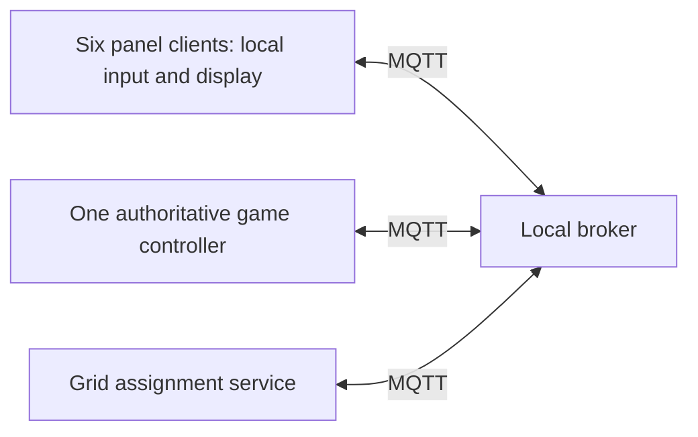
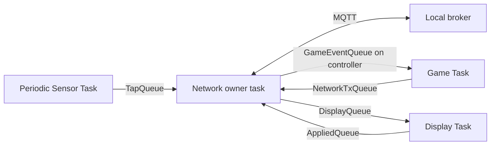

# MQTT coordinator guide and protocol v1

**Recovery implementation update:** [RECOVERY.md](RECOVERY.md) defines the binary
recovery envelope now implemented. Its token/state/applied/resume exchange
supersedes the proposed JSON recovery examples below. Game encoding and the
controller all-panel barrier remain application integration work.


Status: proposed application contract; transport capabilities implemented below.
This document does not claim the full game or FreeRTOS integration is finished.

## 1. Start here

Each Pico is a **client**. A **broker**, running on a local PC or Raspberry Pi,
receives publications and forwards them to clients with matching subscriptions.
The Wi-Fi router connects devices; it does not automatically run an MQTT broker.
A topic is an address, such as `se4/memorygame/v1/nodes/p01/tap`.
The payload is the content, such as a short JSON tap event. Neither the topic nor
MQTT decides whether that tap is a legal move: the game engine decides.

QoS 0 is best effort. QoS 1 adds a broker acknowledgement and can deliver a
message more than once. A retained publication saves the latest value on that
topic for future subscribers. Retain state, never physical tap events: otherwise
a reconnect could look like a new tap. Last Will is an offline message registered
when connecting; the broker publishes it after detecting an unexpected loss.

Your ownership: connection management, protocol, delivery results and routing.
Hafizhah owns game rules and authoritative state. Nabillah owns unique grid
assignments and their persistence. Input/display owners produce taps/apply state.

## 2. System and ownership



Controller and grid services are logical roles; they can run on panel nodes.
Team decision still needed: which boards host them. The intended hardware is two masters and four slaves, with all six boards
remaining selectable card panels and no dedicated scoreboard. The two master
responsibilities still need an explicit split; only one owns game state.

Use a stable hardware-derived node ID (for example Pico board unique ID), never
its current grid position, as its MQTT identity. `p01` below is an example ID.
Every board must have a unique client ID. Grid positions are 0..5, row-major in
two rows and three columns; layout owner must confirm this orientation.

## 3. Topic contract

Root: `se4/memorygame/v1`. JSON is UTF-8, at most 256 bytes, with no terminating
NUL transmitted. Topics are at most 95 bytes. Fields below are required examples;
reject unknown protocol version, invalid types/ranges or oversized messages.

| Suffix | Publisher -> subscriber | QoS | Retain | Example payload |
| --- | --- | --- | --- | --- |
| `nodes/p01/status` | node -> controller/layout | 1 | yes | `{"v":1,"boot":"b7","online":true}` |
| `nodes/p01/heartbeat` | node -> controller | 0 | no | `{"v":1,"boot":"b7","seq":12}` |
| `nodes/p01/assignment` | layout -> node/controller | 1 | yes | `{"v":1,"layout":2,"pos":0}` |
| `nodes/p01/tap` | node -> controller | 1 | no | `{"v":1,"game":"g9","boot":"b7","seq":3,"rev":7}` |
| `nodes/p01/state` | controller -> node | 1 | yes | `{"v":1,"game":"g9","rev":8,"layout":2,"mode":"playing","face":"revealed","image":2}` |
| `nodes/p01/applied` | node -> controller | 1 | no | `{"v":1,"game":"g9","boot":"b7","rev":8,"layout":2}` |
| `nodes/p01/sync` | node -> controller/layout | 1 | no | `{"v":1,"boot":"b7"}` |

Node subscribes to its assignment and state. Controller subscribes to
`nodes/+/status`, `nodes/+/heartbeat`, `nodes/+/tap`, `nodes/+/applied`, and
`nodes/+/sync`, each prefixed with the root. This fits eight filters.
Layout service subscribes to status and sync. Assignment is a retained registry,
not a broker-generated decision. Only the layout owner publishes assignments;
it checks both node-to-position and position-to-node mappings before committing.
Keep a persistent registry and reconcile retained records before assigning after
restart. Retention alone does not prevent competing writers or duplicates.

`boot` changes every node restart; `seq` increases within that boot.
`game` is a new unique session token after each restart/new game; `rev` increases
on each authoritative state change. Define counters as unsigned 32-bit values;
start a new boot/game before wrap. `layout` identifies the assignment generation.
State modes are `initializing`, `playing`, `paused`, `complete`; faces are
`hidden`, `revealed`, `matched`. `image` indexes local graphics, not pixel data.
Send only the image needed for the current visible state; hidden uses image 0.

The retained Will uses the same status topic and boot as the online message,
with `online:false`. Online transport presence does not mean ready for play.
For graceful shutdown, publish offline and await broker ACK before disconnect.
The transport currently has no graceful-disconnect API.

## 4. Tap, ordering and duplicate handling

1. Input owner detects one debounced tap and queues it to the network owner.
2. Network owner publishes the tap at QoS 1, without retaining it.
3. Controller validates node registration, boot, game, layout synchronisation,
   playing mode and revision, then passes valid events to the game queue.
4. Controller processes its receive FIFO serially. Arrival order is the tie-break
   for simultaneous taps; do not compare timestamps from unsynchronised Picos.
5. Controller records `(node, boot, seq)` before executing a tap. Duplicate or
   older sequence numbers do not execute again. A higher sequence is only
   accepted for the boot established by a fresh sync handshake.
6. Game owner evaluates the move and publishes complete desired state for every
   affected node. Only this state can trigger a reveal. Same-card cancellation,
   matched-card rejection and mismatch input locking belong to the game owner.

The controller accepts a tap only for the node's last applied revision; stale
events trigger a state resend rather than an action. Nodes apply same-game state
only when its revision is newer (equal means acknowledge again without replaying
an animation). Different games require a fresh sync handshake. Do not replay
queued physical inputs after disconnect: they may no longer be valid moves.

## 5. Disconnect and recovery

Publish heartbeats every 1 second. Controller uses its own receipt clock; no
fresh heartbeat for 3 seconds makes a required node unavailable. Retained online
status is only a hint: it may be old after a broker restart. Require fresh live
sync and heartbeats. Last Will is a backup, not a 0.2-second fault detector.
With a 10-second MQTT keepalive, silent-loss detection can take about 15 seconds.

On local connection loss, disable input and notify the display owner. Controller
notifies the game owner of an unavailable required node; game owner pauses and
preserves progress and remaining mismatch time, then publishes paused state.
Broker loss makes every node stop accepting input locally, even if no Will can
be delivered. On reconnect restore subscriptions, send online and sync, receive
assignment plus full state, and publish applied only after display/state owners
have installed that state. Controller resumes only after all six required nodes
acknowledge the current game, layout and revision. An MQTT PUBACK is insufficient.

If applied is missing for 200 ms, resend current desired state, up to three
attempts before reporting sync failure and remaining paused. Retry only current
state, never old animations or taps. Queue overflow similarly forces resync;
the transport's discard counter makes received loss visible.

Controller reboot recovery is not implemented: fail closed and start a new game
after synchronising all required nodes unless the game owner adds persistent
state. Local broker configuration should enable retained persistence if registry
restoration across broker restarts is required.

## 6. Code you can use now

After Wi-Fi architecture initialisation, before the first MQTT connection:

```c
// Application constructs the full topic and its boot-specific JSON.
mqtt_configure_will(status_topic, offline_json, 10);
mqtt_subscribe_topic_qos(state_topic, 1);
mqtt_subscribe_topic_qos(assignment_topic, 1);
```

Check every return value. Keep calling `init_mqtt_client(client_id)` to service
connection/subscription retries. Once `mqtt_is_ready()` is true:

```c
bool queued = mqtt_send_ex(status_topic, online_json, strlen(online_json),
                           1, true, NULL, NULL);
// queued means lwIP accepted it, not that another node applied it.
```

`mqtt_send_ex` accepts QoS 0/1, retain, and an optional completion callback.
Completion result 0 for QoS 1 means broker PUBACK. Callbacks run under lwIP:
only record a flag or notify a task; never render, block, or re-enter MQTT APIs.
No callback is guaranteed after connection loss. Resolve uncertain delivery via
application synchronisation. The old send/subscribe APIs remain QoS 0 wrappers.

Current `main.c` remains the two-board colour demo using legacy topics. It now
registers retained `offline` Last Will and publishes retained `online` status on
`se4/memorygame/nodeN/status`; it does not implement the v1 JSON game protocol.
All other existing demo commands remain unretained QoS 0.

## 7. FreeRTOS integration contract



Current firmware uses FreeRTOS with `pico_cyw43_arch_lwip_sys_freertos`,
`NO_SYS=0`, one Network Task and a separate Application Task. Wi-Fi initialises
inside the running Network Task. Public application calls queue copied messages
through `network_publish()` and `network_receive()`; see [FREERTOS.md](FREERTOS.md).
SDK service tasks still exist below the owner. Sensor/display remain together in
the demo Application Task; dedicated game/sensor/display queues are team
integration work. Priorities and queue sizes require hardware measurement.

## 8. Validation and remaining work

Implemented: QoS-aware subscriptions/publishing, retained publishing, owned Will
configuration, completion forwarding, legacy API compatibility and demo presence.
Host tests cover options, input validation, Will copying/reconnect persistence,
callback forwarding, receive overflow and subscription restoration.

Still to implement with owners: JSON parsing/validation, stable boot/game IDs,
heartbeat monitoring, assignment registry, duplicate filtering, state/applied
handshake, game routing and dedicated sensor/display tasks. Wi-Fi rejoin attempts and
the generic FreeRTOS queues/tasks are implemented but need hardware validation. These are not provided by
the generic transport. Local broker address and physical controller role remain
deployment/team settings.

Measure NFRs as nonnegative end-to-end durations, target <=200 ms:

| Measurement | Start -> finish |
| --- | --- |
| Tap-to-reveal | physical tap -> actual visible panel update (video/logic analyser) |
| Resync | MQTT accepted -> assignment and state installed, applied received |
| Grid assignment | layout initialisation -> all six position displays applied |

Log sample count, worst case, loss and retries under simultaneous taps and LED
load; broker round-trip alone does not measure physical tap-to-reveal.
Test two nodes first: publish duplicate taps, pull power mid-turn, restart broker,
reconnect during mismatch, fill receive queue, and verify no stale reveal occurs.
Then repeat with six nodes. No latency or hardware reliability claim is made yet.

References: [lwIP MQTT API](https://www.nongnu.org/lwip/2_1_x/group__mqtt.html),
[lwIP connection fields](https://www.nongnu.org/lwip/2_1_x/structmqtt__connect__client__info__t.html),
[MQTT 3.1.1 specification](https://docs.oasis-open.org/mqtt/mqtt/v3.1.1/os/mqtt-v3.1.1-os.html).
